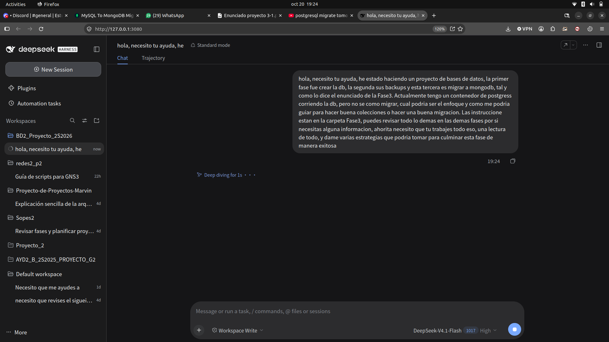
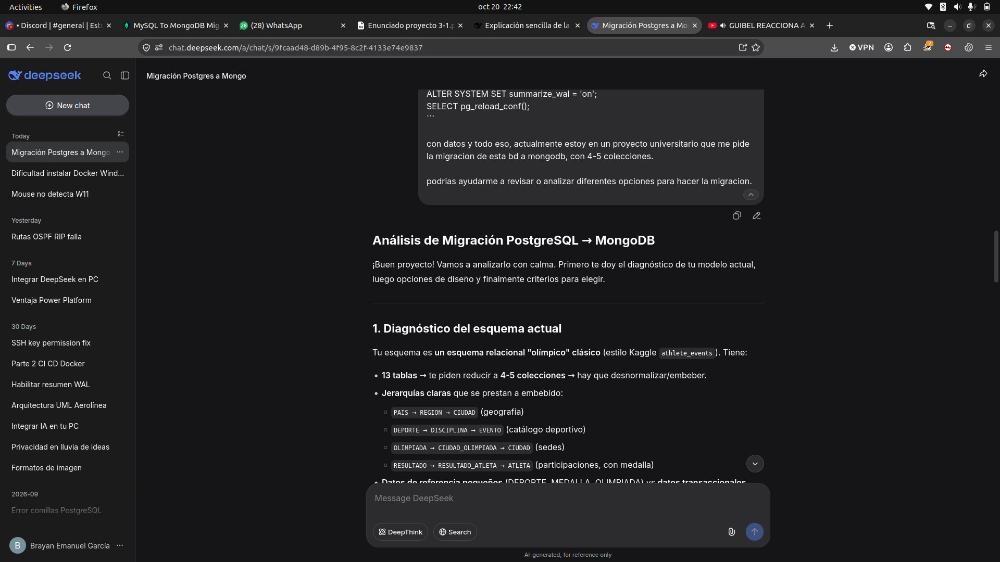
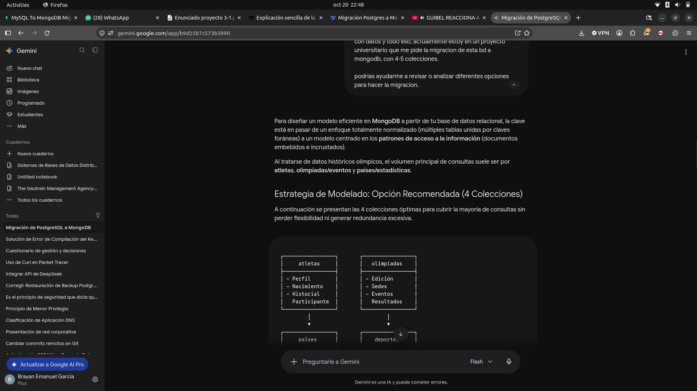
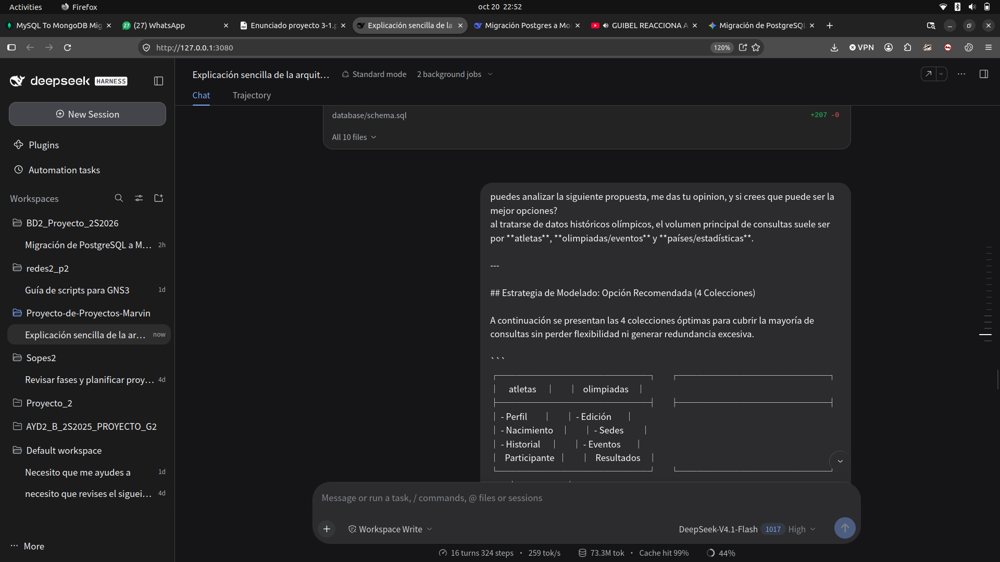
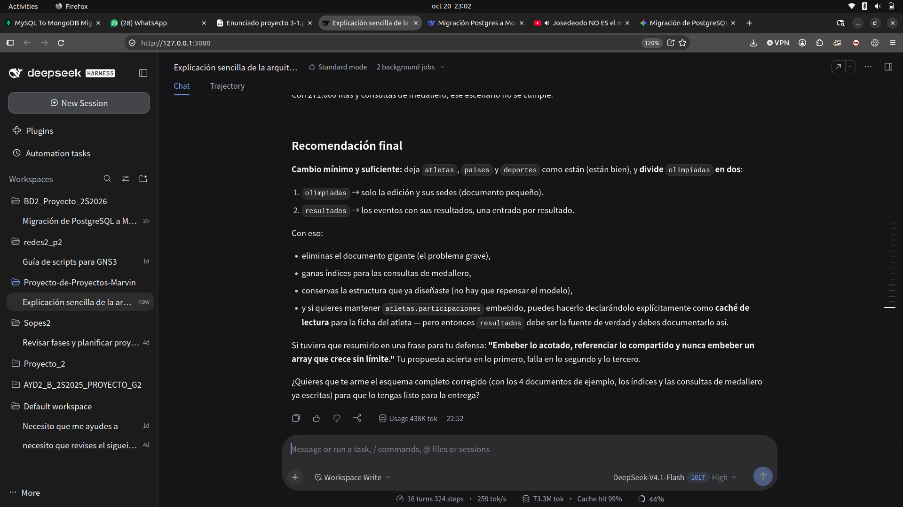
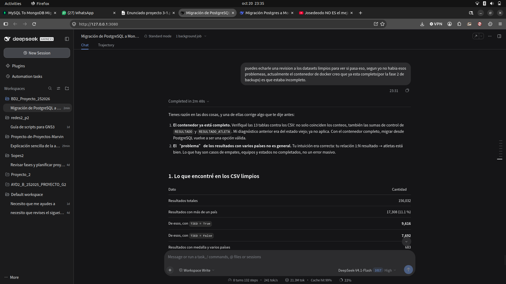

# 07 — Evidencias de consultas a IA

Este documento reúne las capturas del proceso de consulta y revisión del
diseño. Las imágenes son **evidencia del proceso**, no la especificación
final: varias ideas se ajustaron después de validar los datos y las consultas.

La decisión final está documentada en
[`01_Diseno_4_Colecciones.md`](01_Diseno_4_Colecciones.md) y en
[`../../README.md`](../../README.md).

---

## 1. Planteamiento inicial del problema

Consulta inicial: migrar la base olímpica de PostgreSQL a MongoDB, entender el
modelo y elegir una estrategia.

*Captura del 20 de octubre de 2026: primer mensaje con el contexto del
proyecto, el contenedor PostgreSQL y las dudas sobre el modelado.*

---

## 2. Análisis del esquema relacional

La IA revisa las 13 tablas, las jerarquías y las opciones de desnormalización.

*Diagnóstico del esquema: `PAIS → REGION → CIUDAD`, `DEPORTE → DISCIPLINA →
EVENTO`, `OLIMPIADA → CIUDAD_OLIMPIADA` y el bloque de resultados.*

---

## 3. Propuesta inicial de 4 colecciones

Una de las propuestas iniciales: `atletas`, `olimpiadas`, `paises` y
`deportes`, con los resultados embebidos en `olimpiadas`.

*Captura de una consulta a Gemini con la propuesta de 4 colecciones y el
diagrama inicial.*

---

## 4. Revisión crítica de la propuesta

Se analiza si la propuesta inicial era la mejor: se discuten la duplicación de
resultados, el tamaño del documento de `olimpiadas` y la necesidad de separar
los hechos.

*Consulta con la propuesta completa de 4 colecciones para pedir una opinión y
una comparación con otras alternativas.*

---

## 5. Separar `olimpiadas` y `resultados`

La recomendación que terminó pesando en el diseño: `olimpiadas` solo guarda la
edición y sus sedes; los resultados pasan a su propia colección.

*Propuesta de dividir `olimpiadas` en `olimpiadas` (metadata) y `resultados`
(hechos), con índices para medalleros.*

---

## 6. Revisión de los CSV y del contenedor

Se revisó si los resultados con varios países eran un error general. La
conclusión: son principalmente empates, equipos y estados no completados; solo
una minoría requiere revisión. También se verificó que el contenedor
PostgreSQL ya estaba completo.

*Captura con el análisis de 156,032 resultados, 17,308 con más de un país,
9,616 empatados y 7,692 no empatados, además del estado del contenedor.*

---

## 7. Qué se conservó de estas consultas

| Idea inicial | Decisión final |
|---|---|
| `atletas` con historial embebido | `atletas` con perfil + `resumen`; el historial se consulta en `resultados` |
| `olimpiadas` con todos los resultados | `olimpiadas`/`juegos` en `catalogos`; los resultados van a `resultados` |
| `paises` solo con geografía | `paises` con geografía, población, sedes y resumen |
| `deportes` como catálogo | `catalogos` con juegos, deportes, disciplinas, eventos y medallas |
| 4 colecciones | **4 colecciones**: `atletas`, `resultados`, `paises`, `catalogos` |

El resultado final está implementado y validado en
[`../evidencia/fase5/validacion.md`](../evidencia/fase5/validacion.md).
